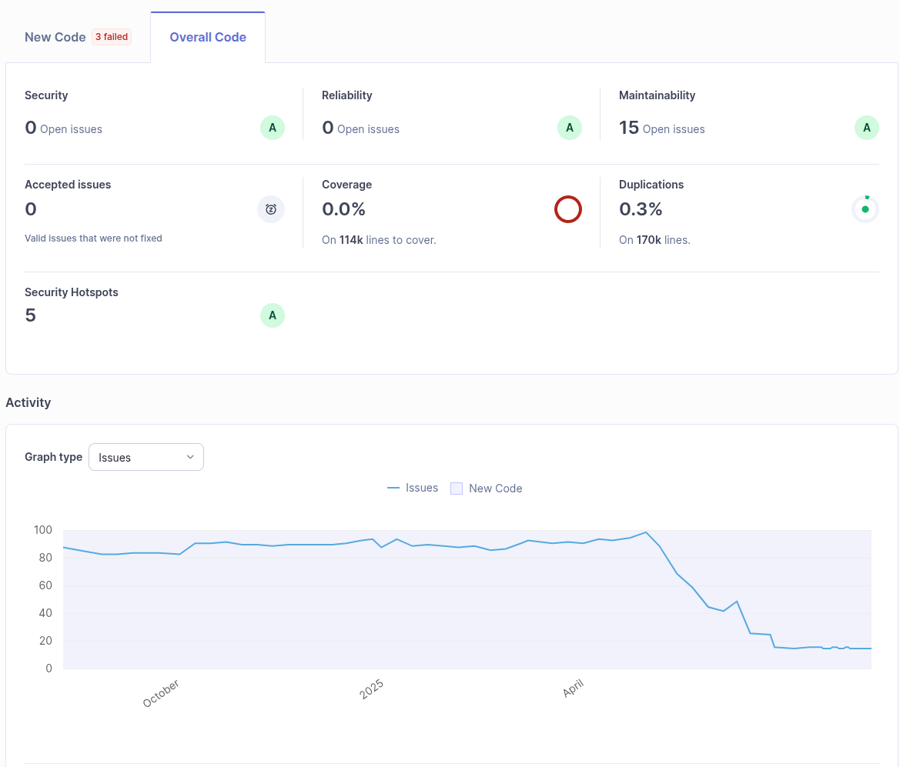

# Source Code Information

See also [dependencies](./Dependencies.md).

These statistics do not include the build or packaging files.

The binary package sizes vary widely, see for example [lightweight win32 installations](https://github.com/Xpra-org/xpra/issues/4100).


<div class="docs-section-heading" markdown="1">

## Metrics

</div>

### Reproducing and graphing the statistics

Run the scripts from the repository root with Python 3.12 or newer and Git. Data
collection uses the standard library and reads committed Git objects, so it does
not require building Xpra, loading codecs, or checking out other branches. Local
changes and untracked build artifacts do not affect the results.

Generate the five-branch comparison and publication assets:

```shell
python3 fs/bin/source_report_history.py --evolution \
    --cache-dir /tmp/xpra-source-cache --output-dir /tmp/xpra-source-report
python3 fs/bin/source_report_graphs.py /tmp/xpra-source-report/metrics.json \
    --output-dir /tmp/xpra-source-report
```

The graph renderer requires Matplotlib and runs without a display. The output
directory contains `metrics.json`, `metrics.csv`, `report.md`, and SVG/PNG graphs.
Copy these files together to publish the report. Graphs can be regenerated from
the saved JSON without access to Git. JSON includes the detailed class/module
relationships, file rankings, diagnostics, and metric definitions; CSV contains
one summary row per branch and snapshot.

The default refs are `v1.0.x v3.1.x v5.1.x v7.x master`. Supply positional refs
before the options to override them. Explicit refs must exist locally; the
collector never fetches. Local branches can lag remote branches, so use explicit
`origin/...` refs when those are the intended snapshots.

For historical graphs, sample the last first-parent commit in each month or
quarter, or version tags on the first-parent history:

```shell
python3 fs/bin/source_report_history.py master --evolution --sample quarterly \
    --since 2016-01-01 --cache-dir /tmp/xpra-source-cache \
    --output-dir /tmp/xpra-source-history
```

`--sample tags` selects tags matching `v[0-9]*`; `--sample monthly` is also
available. `--since` and `--until` bound sampling by commit timestamp (ISO dates,
UTC by default); the requested tips are always included. Snapshots sharing a
commit are collected once. Bars compare branch tips as categories; history graphs
use actual commit dates, rather than the original release years. A maintenance
branch tip may be much newer than its first release.

### Metric definitions and comparison limits

- **Size and files:** headline groups are `.py`, `.pyx+.pxd+.pxi`, and
  `.c+.h+.cpp+.m`. Per-extension totals and other source extensions are also
  exported. Scope defaults to `xpra/`, automatically adapting to `src/xpra/` on
  older branches. Tests, packaging, and build scripts are excluded by default;
  override with `--paths` as needed.
- **SLOC:** estimated physical source lines excluding blank and comment-only
  lines. Python docstrings count as code; mixed code/comment lines count as code.
  Native comment handling is lexical and can misinterpret comment markers inside
  string literals. KLOC is estimated SLOC divided by 1,000. This is a size measure,
  not a measure of quality or functionality.
- **Codecs:** unique identities declared by the codec loader, before platform
  filtering. Encoder, decoder, converter, filter, and capture roles are listed
  separately. Counts represent implementations, not unique media formats or
  libraries installed on the machine. Unresolved loader expressions produce
  diagnostics and unavailable values, with no package-count fallback.
- **Subsystems:** implementation modules under historical `mixins` and current
  `subsystem` directories, including toolkit-specific implementations; package
  initializers and stubs are excluded. Client and server counts include an
  architecture label. Earlier monolithic versions are not applicable, rather
  than zero. These structural counts do not claim feature equivalence.
- **Static CBO:** distinct resolvable internal classes referenced by each Python
  class, including constructors, annotations, and class-member references. Self
  references and inheritance-only references are excluded; bases are exported
  separately. Aliases and relative imports are resolved conservatively. Dynamic
  dispatch, inferred instance types, re-export chains, and string annotations
  are not resolved. Unresolved references are exported for inspection.
- **Module coupling:** statically declared internal imports, including imports
  inside functions and conditionals. Fan-in counts importing modules; fan-out
  counts imported modules. Dependency cycles are strongly connected groups.
- **Sizes:** file estimated SLOC and function physical-line distributions
  (median, nearest-rank p90, maximum). Function sizes include nested bodies and
  docstrings, starting at `def`/`async def`; decorators are excluded. Rankings
  identify the largest files and functions.
- **Hotspots:** additions, deletions, and file-change frequency over the preceding
  365 days, following renames and excluding merge commits. Deleted files can
  appear in these rankings. This is change activity, not a bug count.

AST metrics apply only to parseable `.py` files. Coverage reports identify syntax
failures and all excluded non-Python files. An incomplete snapshot still exports
usable size data and available analyses, with explicit diagnostics. Missing
measurements are shown as N/A, never silently changed to zero.

### Code age and historical half-life

These analyses are optional and substantially slower than snapshot statistics.
They require complete Git history; shallow repositories are rejected. Use a
cache directory to reuse completed results.

```shell
python3 fs/bin/source_report_history.py master --evolution --age \
    --survival v3.1..master --cache-dir /tmp/xpra-source-cache \
    --output-dir /tmp/xpra-source-lifetime
```

`--age` measures the age of each surviving estimated source line at the snapshot,
using blamed committer timestamps. It exports median age in days and age bands.
Negative ages caused by inconsistent commit clocks are clamped to zero. Blame
ignores whitespace changes and detects moves within and between files using
Git's default thresholds (`-w -M -C`), including file renames.

`--survival BASE..END` follows a baseline's estimated source lines forward using
reverse blame along END's first-parent history. BASE must be on that history;
a maintenance branch tip usually cannot serve as a baseline for master. Supply
an ancestor release tag or commit instead. Repeat the option for multiple curves.
Baseline lines are tracked independently of newly added code, including edits,
renames, and deletions.

Historical half-life is the elapsed time until at most 50% of the baseline's
lines survive. If that threshold is not reached, the report says **not reached**
and gives the observation duration. An incomplete trace does not publish a
half-life or survival curve. Median current-line age and historical half-life
answer different questions and are reported separately. Blame provides a
heuristic account of textual survival, not semantic equivalence after rewrites.

The existing compact reports remain available without `--evolution`:

```shell
python3 fs/bin/source_report_history.py v1.0.x v3.1.x v5.1.x v7.x master --format markdown
python3 fs/bin/source_report.py --ref master --format json
```

The table below is an earlier manually published report; its codec counts may
use package counts on older branches and its columns differ from the grouped
evolution report. Regenerate comparable values with the commands above.

| Ref | Branch Date | Files | SLOC | Py Files | Py SLOC | Pyx Files | Pyx SLOC | Modules | Codecs | Commits Since Base |
| --- | --- | ---: | ---: | ---: | ---: | ---: | ---: | ---: | ---: | ---: |
| master | 2026-06-05 | 1,073 | 191,733 | 910 | 150,167 | 106 | 30,793 | 1,016 | 38 | 0 |
| v6.5.x | 2026-05-14 | 994 | 177,593 | 852 | 144,087 | 98 | 28,230 | 950 | 32 | 1 |
| v6.4.x | 2026-01-28 | 905 | 165,635 | 780 | 134,818 | 90 | 26,542 | 870 | 31 | 122 |
| v5.1.x | 2023 | 672 | 150,079 | 571 | 120,846 | 69 | 24,826 | 640 | 31 | 1,445 |
| v3.1.x | 2019 | 575 | 124,452 | 491 | 101,459 | 52 | 19,828 | 543 | 19 | 2,130 |
| v1.0.x | 2016 | 373 | 78,116 | 320 | 64,215 | 37 | 13,675 | 357 | 20 | 777 |

<div class="docs-section-heading" markdown="1">

## Copyrights

</div>

| Holder | File Count | Files |
| --- | ---: | --- |
| Andrew Resch <andrewresch@gmail.com> | 1 | [xpra/net/rencodeplus/rencodeplus.pyx](xpra/net/rencodeplus/rencodeplus.pyx) |
| Antoine Martin <antoine@xpra.org> | 1,012 |  |
| Arthur Huillet | 2 | [xpra/codecs/csc_cython/converter.pyx](xpra/codecs/csc_cython/converter.pyx), [xpra/codecs/libyuv/converter.pyx](xpra/codecs/libyuv/converter.pyx) |
| Chris Marchetti <adamnew123456@gmail.com> | 1 | [xpra/platform/posix/proc.py](xpra/platform/posix/proc.py) |
| Daniel Woodhouse | 1 | [xpra/gtk/notifier.py](xpra/gtk/notifier.py) |
| eryksun | 1 | [xpra/platform/win32/printer_notify.py](xpra/platform/win32/printer_notify.py) |
| Jeremy Lainé | 1 | [xpra/net/quic/session_ticket_store.py](xpra/net/quic/session_ticket_store.py) |
| Joel Martin | 1 | [xpra/net/websockets/header.py](xpra/net/websockets/header.py) |
| Markus Pointner | 1 | [xpra/util/colorstreamhandler.py](xpra/util/colorstreamhandler.py) |
| Microsoft Corporation. All rights reserved | 1 | [xpra/platform/win32/setappid.cpp](xpra/platform/win32/setappid.cpp) |
| mjharkin | 2 | [xpra/net/websockets/headers/browser_cookie.py](xpra/net/websockets/headers/browser_cookie.py), [xpra/net/websockets/headers/env_cookie.py](xpra/net/websockets/headers/env_cookie.py) |
| Nathalie Casati <nat@yuka.ch> | 1 | [xpra/auth/keycloak.py](xpra/auth/keycloak.py) |
| Nathaniel McCallum <nathaniel@natemccallum.com> | 1 | [xpra/net/libproxy.py](xpra/net/libproxy.py) |
| Nathaniel Smith <njs@pobox.com> | 157 |  |
| Netflix, Inc | 29 |  |
| Pierre Ossman | 1 | [xpra/net/websockets/header.py](xpra/net/websockets/header.py) |
| Richard Outerbridge | 1 | [xpra/net/rfb/d3des.py](xpra/net/rfb/d3des.py) |
| Serviware (Arthur Huillet, <ahuillet@serviware.com>) | 35 |  |
| Yann Collet | 1 | [xpra/buffers/xxh3.h](xpra/buffers/xxh3.h) |
| Yusuke Shinyama | 1 | [xpra/net/rfb/d3des.py](xpra/net/rfb/d3des.py) |


---

<div class="docs-section-heading" markdown="1">

## Quality

</div>

<div class="docs-section-heading" markdown="1">

## Sonarqube:

</div>

Updated 2025-08-13

The code coverage is not currently recorded by sonarqube.

<div class="docs-section-heading" markdown="1">

## Github Workflows

</div>

The [unit tests](https://github.com/Xpra-org/xpra/tree/master/tests/unittests)
are run with every `git push` via [`test.yml`](https://github.com/Xpra-org/xpra/blob/master/.github/workflows/test.yml).

The source code is also compiled with [extra cythonization](https://github.com/Xpra-org/xpra/issues/3978)
which takes advantage of type hints to verify stronger type safety.


<div class="docs-section-heading" markdown="1">

## Other linters used

</div>

* `pycharm` builtin linter, during development
* `ruff` via a [git pre-commit hook](https://github.com/Xpra-org/xpra/blob/master/.pre-commit-config.yaml)
