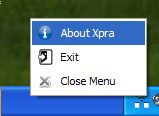

# Share a desktop that is already in use

Shadow mode lets you view and control the desktop that is currently displayed
on another computer. Use it for remote assistance or to return to work that is
already open on a physical desktop.

It works with Linux, macOS, and Windows servers. The display usually needs to
be active and unlocked. If you want a separate remote session instead, use
[desktop mode](Desktop.md); to run only selected applications, use
[seamless mode](Seamless.md).

## Connect securely with SSH

If Xpra is installed on the remote computer and you can log in to it with SSH,
start sharing its current desktop with one command:

```shell
xpra shadow ssh://HOST/
```

Replace `HOST` with the remote computer’s name or IP address. The shadow
server stops when you disconnect, leaving the desktop itself untouched.

If you prefer a graphical tool, open **Xpra** from your application menu and
choose **Shadow**. Enter the remote computer’s address and credentials there.

## Control another computer from a small window

To drive another computer's keyboard and pointer like a software KVM, without
giving its whole screen space on yours, show it as a thumbnail and turn on
input capture:

```shell
xpra shadow ssh://HOST/ --desktop-scaling=0.1 --input-capture=click
```

The remote desktop then appears at a tenth of its size. Click the thumbnail to
capture your pointer and keyboard: every key and click goes to the remote
computer, and your mouse moves the remote pointer across its whole desktop at
its native resolution, not ten remote pixels at a time. Your local pointer is
hidden while captured, and the thumbnail shows where the remote pointer is.

Press the shortcut modifiers with `Escape` (`#+Escape`, see `--key-shortcut`)
to release the capture: your pointer reappears over the thumbnail, where the
remote pointer is. The same shortcut captures again without clicking.
Set `XPRA_INPUT_CAPTURE_SENSITIVITY` to a value other than `1.0` to make the
remote pointer move faster or slower than your mouse.

Input capture needs an X11, Windows or macOS client: GTK3 cannot warp the
pointer on Wayland, so a Wayland client keeps the normal behaviour.

## Before you share

- Anyone connected can see the display and, unless input is disabled, control
  its keyboard and pointer. Confirm that sharing it is appropriate.
- Screen capture can use more CPU on both computers than a regular Xpra
  session, especially at high resolutions or with rapidly changing content.
- For an existing Xpra seamless or desktop session, attach directly instead of
  shadowing it. Direct attachment preserves Xpra’s normal window and display
  handling.

<details markdown="1">
<summary>Keep a shadow server running or connect without SSH</summary>

Start a persistent shadow server manually when you need to configure it more
closely:

```shell
xpra shadow :0
```

On Linux and other X11 systems, `:0` commonly means the primary display. On
macOS and Windows there is no X11 display name, so omit it. You can also omit
it when the system has only one active display.

To accept TCP connections, bind an address and port:

```shell
xpra shadow :0 --bind-tcp=0.0.0.0:10000
```

This TCP example intentionally has no authentication or encryption. Do not
expose it beyond a trusted network until you have configured both
[authentication](Authentication.md) and [encryption](../Network/Encryption.md).
</details>

<details markdown="1">
<summary>Diagnostics and implementation details</summary>

While the server is running, it is also available through its Unix-domain
socket. For example:

```shell
xpra info ssh://HOST/DISPLAY
```

Use `-d ssh` or another relevant category to enable
[debug logging](Logging.md). The shadow server also displays a system-tray
menu while it is running and changes its icon when a client connects.



For general diagnostic steps, see [Debugging Xpra](../Debugging.md).

Known platform-specific work is tracked in these issues:

- [#899](https://github.com/Xpra-org/xpra/issues/899) generic shadow improvements
- [#389](https://github.com/Xpra-org/xpra/issues/389) Windows shadow server improvements
- [#558](https://github.com/Xpra-org/xpra/issues/558) NVENC support for shadowing on Windows
- [#390](https://github.com/Xpra-org/xpra/issues/390) damage events for the POSIX shadow server
- [#391](https://github.com/Xpra-org/xpra/issues/391) macOS shadow server improvements
- [#530](https://github.com/Xpra-org/xpra/issues/530) resize shadow windows on the client
- [#972](https://github.com/Xpra-org/xpra/issues/972) fullscreen mode in the client
- [#1099](https://github.com/Xpra-org/xpra/issues/1099) keyboard layout on Windows
- [#1150](https://github.com/Xpra-org/xpra/issues/1150) named pipes for Windows
- [#1321](https://github.com/Xpra-org/xpra/issues/1321) scrolling with the macOS shadow screen
- [#1322](https://github.com/Xpra-org/xpra/issues/1322) resizing the macOS shadow screen
</details>

## Next steps

- [Connect to and configure Xpra clients](Client.md)
- [Use SSH or another connection method](../Network/README.md)
- [Forward clipboard, audio, and other features](../Features/README.md)
