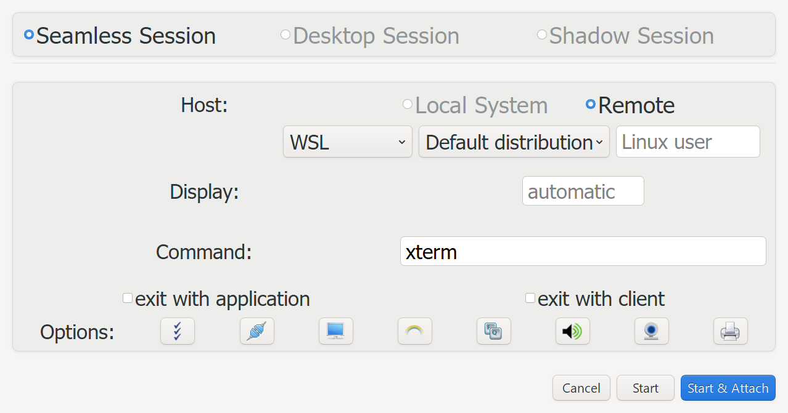
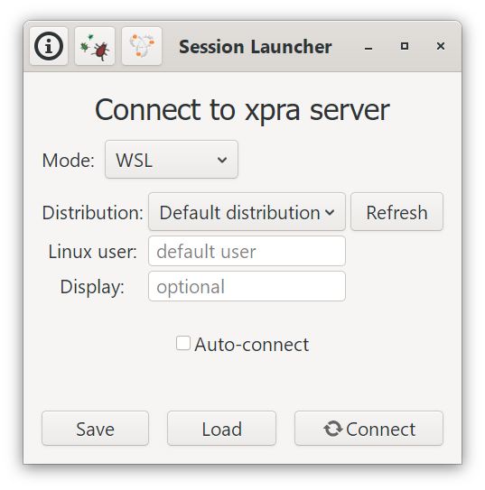

# Windows Subsystem for Linux (WSL)

<div class="docs-grid docs-screenshot-grid" markdown="1">
<section class="docs-card docs-screenshot-card" markdown="1">

### Start a session

<a class="docs-screenshot-link" href="../images/screenshots/xpra-start-wsl.png">

</a>

Use **Start** with the `Remote` host and the `WSL` mode to start an application
in a new session, or in one that is already running.

</section>

<section class="docs-card docs-screenshot-card" markdown="1">

### Connect to a session

<a class="docs-screenshot-link" href="../images/screenshots/xpra-launcher-wsl.png">

</a>

Use **Connect** in `WSL` mode to re-attach to a session that is already running.
See [the graphical interface](#from-the-graphical-interface) below for details.

</section>
</div>

This page covers running an Xpra server in a Linux distribution hosted by WSL
and connecting to it from Windows. This is useful when applications should keep
running after their client disconnects, or when the Linux session is to be used
from another Xpra client.

It is not necessary to use Xpra just to show a Linux graphical application on
Windows. On supported Windows 11 systems, WSLg can display Linux GUI
applications directly in Windows. Xpra adds its usual persistent sessions,
seamless windows, and remote-access features on top of that.

## Prerequisites

Use a current WSL 2 installation and a supported Linux distribution. From an
elevated PowerShell prompt, a new installation can normally be created with:

```powershell
wsl --install
```

Use `wsl --update` to update an existing installation and `wsl -l -v` to check
that the distribution uses version 2. Microsoft's [WSL installation
guide](https://learn.microsoft.com/windows/wsl/install) has the current
requirements and installation alternatives.

WSLg is included with current WSL on Windows 11. It provides the Wayland and
X11 display services used by Linux GUI applications, as well as audio and
clipboard integration. The [WSLg architecture
overview](https://devblogs.microsoft.com/commandline/wslg-architecture/)
explains how those pieces fit together.

## Install Xpra

Install the official Xpra packages in the WSL distribution. The default Debian
and Ubuntu repositories provide outdated or broken downstream packages that do
not work with current Xpra clients; see
[Distribution Packages](https://github.com/Xpra-org/xpra/wiki/Distribution-Packages).
Run the automatic setup script inside the WSL distribution to configure the
official repository and install Xpra:

```shell
curl https://xpra.org/get-xpra.sh | bash
```

For manual repository setup, see [Download Xpra](https://xpra-org.github.io/xpra/Download/Linux.html).

Install the native Windows Xpra client as well. The packaged `EXE` or `MSI`
installer is required for Windows integration; see the [client
documentation](Client.md#platform-quirks).

## Start and connect to a session

The Windows client can reach a WSL distribution directly, using `wsl://` connections:
`wsl.exe` runs Xpra in the distribution and the Xpra protocol is carried over its pipes.
There is no TCP port to bind, no password to choose and no SSH server to install.

### From the graphical interface

* **Start Session**: select the `Remote` host and the `WSL` mode, pick a
  distribution (or leave the default one), optionally enter a Linux user and a
  display number - leave it empty to use the first free one from `100`, enter
  the command to run and click `Start & Attach`. Using the display number of a
  session that is already running starts the command in that session.
  Only seamless sessions are available for WSL at the moment.
* **Session Launcher** (`Connect`): choose the `WSL` mode, then the same
  distribution, user and display number to re-attach to a session that is already
  running. The display number can be left empty when only one session is running.
  These settings are kept when saving the session to a `.xpra` file.

The list of distributions is obtained from `wsl --list --quiet`.
Before connecting, the client verifies that `xpra` can be found in the
distribution and shows installation instructions if it cannot.

### From the command line

```powershell
# start xterm in a new session on display 100 of the "Ubuntu" distribution:
Xpra_cmd.exe start wsl://Ubuntu/100 --start=xterm
# or let Xpra choose a free display number, starting at 100:
Xpra_cmd.exe start wsl://Ubuntu/ --start=xterm
# start another application in the session that is already running:
Xpra_cmd.exe start wsl://Ubuntu/100 --start=xclock
# re-attach to it later:
Xpra_cmd.exe attach wsl://Ubuntu/100
# the display number can be omitted when only one session is running:
Xpra_cmd.exe attach wsl://Ubuntu/
# as a specific Linux user:
Xpra_cmd.exe attach wsl://alice@Ubuntu/
# using WSL's default distribution, and its only session:
Xpra_cmd.exe attach wsl://
```

If a command cannot be started in a session that is already running,
a warning is shown and the client still connects to the session.
When attaching without a display number and more than one session is running,
the error lists them and one must be specified.
Run `xpra list` in the distribution to see the sessions and their display numbers.

The distribution name is case-sensitive, names containing special characters
can be URL-encoded (ie: `wsl://My%20Distro/100`). When the distribution or
the user is omitted, WSL's configured default is used. Passwords and ports
are not accepted in `wsl://` addresses.

`Xpra_cmd.exe` is preferable while testing because it prints diagnostics;
add `-d wsl` for details about the `wsl.exe` process.

### Session lifetime

Closing or disconnecting the client terminates its `wsl.exe` process, but the
Xpra server keeps running in the distribution, so applications are still there
when re-attaching.

WSL stops a distribution shortly after its last `wsl.exe` process has exited,
whatever is still running in it, which would terminate the sessions.
To prevent this, the client leaves a hidden `wsl.exe` process running after
disconnecting: it keeps the distribution running for as long as the Linux user
has Xpra servers in it, and exits once the last one has stopped.
There is only one of these per distribution and user, however many sessions
and connections there are.
It can be turned off for a connection with `wsl://Ubuntu/100?keepalive=no`,
or for all connections by setting the environment variable `XPRA_WSL_KEEPALIVE=0`,
the distribution then stops - and the sessions with it - about 25 seconds
after disconnecting.

The sessions do not survive `wsl --shutdown` or a Windows restart. See the
[`.wslconfig` documentation](https://learn.microsoft.com/windows/wsl/wsl-config)
for WSL's own idle settings.

### Using TCP instead

TCP connections are still useful for connecting other clients, ie: the HTML5 client.
Bind Xpra only to WSL's loopback interface. This uses WSL's localhost forwarding
and avoids exposing an unencrypted Xpra TCP listener to the network.

In WSL, start a session and an application (replace `xterm` with an installed
application if necessary):

```shell
XPRA_PASSWORD='choose-a-secret' xpra start :100 --bind-tcp=127.0.0.1:14500,auth=env --start=xterm
```

From PowerShell, set the same password for the client and attach to the
session:

```powershell
$env:XPRA_PASSWORD = 'choose-a-secret'
Xpra_cmd.exe attach tcp://127.0.0.1:14500
```

Do not bind to `0.0.0.0` or a LAN address without configuring suitable
authentication and transport security. For access from another computer,
prefer an SSH connection or TLS and follow the [authentication](Authentication.md)
and [security](Security.md) guidance.

## systemd (optional)

systemd is only needed when Xpra or a related service should be managed as a
system service. Current WSL distributions may already enable it. To enable it
for a WSL 2 distribution, add the following to `/etc/wsl.conf`:

```ini
[boot]
systemd=true
```

Then run `wsl --shutdown` from PowerShell and start the distribution again.
Microsoft's [systemd in WSL documentation](https://learn.microsoft.com/windows/wsl/systemd)
has the version requirements and troubleshooting details. Do not use the old
third-party scripts that replaced WSL's init process.

## OpenGL and WSLg

WSLg can provide GPU-accelerated OpenGL to applications running on its display.
This is distinct from [client-side OpenGL rendering](Client-OpenGL.md). Driver
availability and supported APIs depend on the Windows GPU driver, WSL version,
and hardware. To inspect the renderer in the distribution, install its
`mesa-utils` (or equivalent) package and run:

```shell
glxinfo -B
```

See [server OpenGL acceleration](OpenGL.md) for Xpra display choices and their
limitations. In particular, a normal virtual Xpra display generally uses
software rendering; using an existing WSLg display is a separate setup with
different lifecycle and isolation trade-offs.

<details markdown="1">
<summary>Historical Lenovo laptop setup</summary>

The following notes record the specific machine on which this was originally
tested. They are not general WSL or Xpra installation instructions.

The machine was a Lenovo laptop with an NVIDIA GeForce RTX 3070 Laptop GPU.
After a clean Windows 11 installation, Windows Update, the NVIDIA WSL-capable
driver, and Lenovo Vantage updates were installed. WSL was then installed with
an Ubuntu 20.04 distribution, followed by `mesa-utils` and `gedit`; the latter
appeared to pull in additional Mesa packages needed by this particular test.

The resulting `glxinfo -B` reported direct rendering through D3D12 and the
NVIDIA GPU:

```text
OpenGL vendor string: Microsoft Corporation
OpenGL renderer string: D3D12 (NVIDIA GeForce RTX 3070 Laptop GPU)
OpenGL core profile version string: 3.3 (Core Profile) Mesa 21.0.3
OpenGL version string: 3.1 Mesa 21.0.3
OpenGL ES profile version string: OpenGL ES 3.0 Mesa 21.0.3
```

</details>
