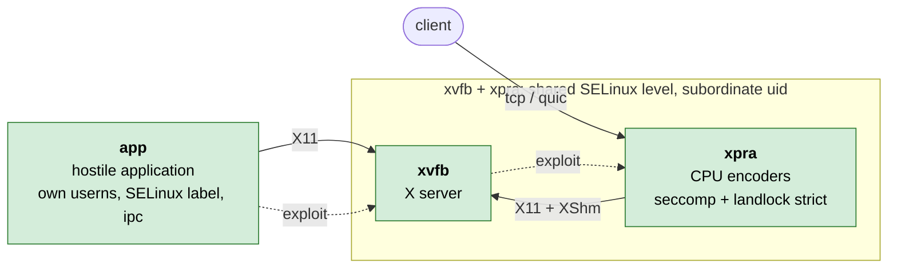
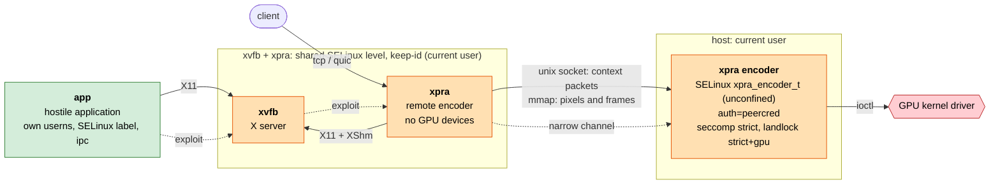
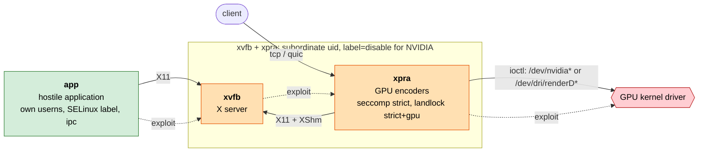

# GPU acceleration and the secure pod

The [secure](./secure/) pod can use the GPU for video encoding in two ways,
which do not have the same security implications:
* [encoder](./encoder/): an `xpra encoder` server running on the host does the encoding, the containers never touch the GPU
* [gpu](./gpu/): the GPU devices are given to the `xpra` container

In all three setups, the threat is the same: the application in the `app` container may be hostile.
It can only reach the X server, and through it the xpra server, so the question is:
what can it reach next if it manages to exploit a vulnerability in the X server or in xpra?

In the diagrams below:
* green: confined by SELinux, using an unprivileged subordinate uid
* orange: not confined by SELinux, or running as the current user
* red: the kernel GPU driver, a large attack surface shared with every other process using the GPU
* the dashed arrows show the path of an attack starting from the application

## Without acceleration

A compromised xpra server is still an unprivileged subordinate uid, confined by SELinux,
without capabilities and with a read-only root filesystem.
It does not have access to the GPU.

## `encoder`: host encoder server

The GPU driver is only reachable from the encoder server, which only parses the video encoding requests
and the pixel data: it never sees the X11 requests, the window metadata or the client connections.

The price is paid by the `xvfb` and `xpra` containers:
they run as the current user (`--userns=keep-id`), because the mmap files and the socket are shared with the encoder server.

SELinux does not allow a container to connect to a socket owned by an unconfined process,
so the encoder server runs in the `xpra_encoder_t` domain from xpra's SELinux policy, which containers are allowed to connect to,
and the `xvfb` and `xpra` containers keep their SELinux label.
This domain is not confined yet ([#5087](https://github.com/Xpra-org/xpra/issues/5087)):
the encoder server has the same privileges as the current user.
Without xpra's SELinux policy, `xvfb` and `xpra` are not confined by SELinux (`--security-opt=label=disable`).

So a compromised xpra server runs as the current user, still confined by SELinux, without capabilities,
with a read-only root filesystem and without access to the user's files:
escaping from the container would then give access to the current user's account.

## `gpu`: GPU devices in the container

The containers keep their subordinate uid, and with the DRI render nodes they also keep their SELinux label.
With NVIDIA devices, SELinux does not allow containers to use them unless the `container_use_devices` boolean is enabled
(for all the containers and all the devices), so `xvfb` and `xpra` are not confined by SELinux.

But the xpra server, which parses the X11 requests from the application and the client connections,
can now reach the GPU kernel driver directly:
a compromised xpra server can attack the driver, which runs in the host's kernel.

## Comparison

| | none | `encoder` | `gpu` |
|---|---|---|---|
| `xpra` container uid | subordinate | current user | subordinate |
| `xvfb` and `xpra` SELinux confinement | yes | with xpra's SELinux policy | DRI: yes, NVIDIA: no |
| GPU driver reachable from | - | the host encoder server | the `xpra` container |
| what the host encoder server parses | - | encoding requests and pixels | - |
| a compromised xpra server can reach | its container | its container as the current user, the encoder server | its container, the GPU kernel driver |
| `app` container | unchanged | unchanged | unchanged |

Neither variant changes the `app` container: it never has access to the GPU,
and it keeps its own user namespace, SELinux label, ipc namespace and network.
