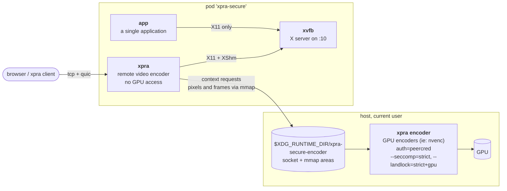

# Encoder

A variant of the [secure](../secure/) pod which uses the GPU for video encoding,
without giving any of the containers access to it:
the video frames are compressed by an `xpra encoder` server running on the host.

The [pod](./pod.sh) script runs the [secure pod](../secure/pod.sh) with `ACCEL=encoder`.
It starts the encoder server first, as a transient systemd user service named `xpra-secure-encoder`
(or as a background process if there is no systemd user session),
it is replaced the next time the pod is started, or it can be stopped with:
```shell
systemctl --user stop xpra-secure-encoder
```



## The encoder server

The encoder server runs on the host, as the current user, so it can use the GPU and its drivers:
it requires the xpra server and the GPU codecs to be installed on the host, ie: `xpra-codecs-nvidia`. \
It must be the same version of xpra as the one in the `xpra` image.

It only listens on a unix domain socket in a private directory (`--bind=none`),
which only accepts connections from the current user (`auth=peercred`).
The threads which parse the network packets are sandboxed using [seccomp](../../../../docs/Usage/Seccomp.md),
and its filesystem access is confined using [landlock](../../../../docs/Usage/Landlock.md), both in `strict` mode,
with the `gpu` flag for landlock (`--landlock=strict+gpu`) so that it can access the GPU devices. \
The video encoders it uses can be selected with `ENCODERS`, ie: `ENCODERS=nvenc ./pod.sh`.

The `xpra` container only gets access to this directory, which contains the encoder server's socket
and the memory mapped files used for sending the pixels and receiving the compressed frames.
The encoder server only opens the files created in this directory, and it validates their contents.

## Trade-offs

See also [GPU acceleration and the secure pod](../GPU.md), which compares this variant with the [gpu](../gpu/) variant.

This is a narrower channel than giving the `xpra` container access to the GPU devices,
as the [gpu](../gpu/) variant does: the encoder server only parses the video encoding requests and the pixel data,
it never sees the application's X11 requests, the client connections or the window metadata.

But the files and the socket are shared with a process running as the current user, which has some costs:
* the `xpra` and `xvfb` containers use `--userns=keep-id`: their uid `1000` is the current user,
  instead of an unprivileged subordinate uid. \
  `xvfb` must use the same mapping, the X server can only use the `XShm` segments of the same user.
* SELinux does not allow containers to connect to a socket owned by an unconfined process,
  so the `xpra` and `xvfb` containers are not confined by SELinux (`--security-opt=label=disable`),
  they must use the same label to share the `XShm` segments.

So a vulnerability exploited in the X server or in xpra gives access to the current user's account,
limited only by the other container restrictions: no capabilities, read-only root filesystem,
no access to the user's files, no network access for `xvfb`, etc.

The `app` container is not affected: it still uses its own user namespace, SELinux label and ipc namespace,
and it does not have access to the encoder server's directory.
